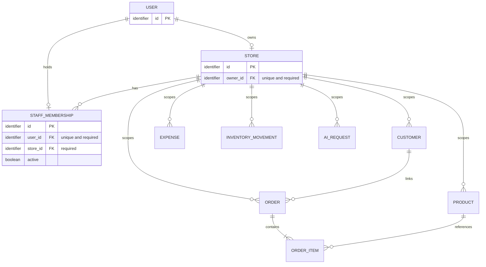

# SellerOS Seller Account and Store Access Model

PLAN-04, 5 October 2026. Documentation and proposed ERD only. **Status: APPROVED WORKING PROTOTYPE RULE — user selected one store per account, owner and staff roles; staff may perform all store operations except user management and store settings.** No authentication system is implemented.

## 1. Sources and current state

[PLAN-02 scope](../requirements/scope.md) leaves account/store cardinality and staff membership open (D-03). [Traceability](../requirements/traceability.csv) requires authorized profile creation/update (FR-01), authenticated server-side store isolation (NFR-01), customer privacy (NFR-02), and normalized store-related records (NFR-08). [PLAN-03](order-and-inventory.md) requires same-store ownership checks before order/inventory effects.


Inspection found a clean working tree on branch `docs`, the existing requirements and PLAN-03 documents, `check.py`, and two source documents. No application, authentication models, API contract or existing access policy exists. PLAN-03's DR-01–DR-08 remain unresolved; PLAN-04 does not change them. The presence of a decision document does not claim that all prerequisite business questions were resolved.

Retain React/Vite/TypeScript and the approved UI libraries, Python/Django/DRF/Django ORM, and PostgreSQL. Authentication/authorization executes server-side. This document neither installs a framework nor selects authentication transport/storage settings.

## 2. Selected account model and staff policy

**APPROVED WORKING PROTOTYPE RULE:** the user selected one store per account with owner and staff roles in this PLAN-04 chat. An owner owns one store after onboarding; a staff account participates in that same store and cannot create a personal second store. An account may have zero stores while owner onboarding is incomplete or staff access is revoked. No multi-store switching or enterprise operations are included.

**APPROVED WORKING PROTOTYPE RULE:** owner provisions staff accounts and assigns one-store membership; user selected the broad staff policy: all store operations except user management and store settings. Staff may manage products, inventory, customers, orders, valid cancellation/return/refund actions and expenses, and access dashboards, profit, assistant drafts, advisor, segmentation, forecast and simulator outputs. This includes financial inputs needed by those approved modules. Owner alone manages staff membership and store settings. Invitation email, SSO and public self-assignment are not assumed.

Both roles obey validation and approved lifecycle rules. Owner status never permits arbitrary status jumps, unsupported refunds, historical rewrites or autonomous actions. Instructor approval is not inferred from user selection. The user selections establish role permissions and owner-controlled provisioning; exact identity/activation mechanics remain a separate implementation prerequisite, listed below.

## 3. Account creation and onboarding policy

1. Prospective owner registers a seller account through the future registration API; account identity and credential validation are server-side. Exact login identifier and verification policy remain AD-02 below.
2. Registration creates an account, not a privileged role or access to any existing store.
3. Eligible prospective owner with no store completes store-profile onboarding. Staff accounts cannot use this flow. The server derives owner from the authenticated account, never from request `owner_id`.
4. Store creation is atomic and constrained to one store per owner, including concurrent submissions. Retry cannot create a second store. Later API conventions must define the duplicate response without changing this invariant.
5. Prospective owner without a store may access its own account/onboarding flow; revoked/unassigned staff cannot create a store through that exception. Neither has seller-record access without an authorized store. A foreign `store_id` cannot bypass onboarding.
6. Login authenticates identity; subsequent protected requests authorize ownership independently. Logout ends authentication according to the later selected transport. Inactive or invalid identity cannot access seller records.

Staff creation is owner-controlled: no supplied role/store ID or public registration can grant staff membership. Existing-account enrollment, initial credentials and activation/recovery mechanics remain AD-02; no email or temporary-password convention is inferred. Membership creation/deactivation is atomic, cannot cross stores, and revocation must apply to future protected requests even if a credential remains otherwise valid.

Only registration/login and deliberately public operational endpoints may be public; business data is never public. Health/readiness output must not expose store records or secrets. Account deletion, store deletion/recreation, recovery, and ownership transfer are not implicit onboarding features.

## 4. Permission matrix for the selected policy

| Actor/state | Own account / onboarding | Store profile | Operational records | Analytics and AI records | Other stores |
| --- | --- | --- | --- | --- | --- |
| Unauthenticated visitor | Registration/login only | Denied | Denied | Denied | Denied |
| Authenticated account without store | Own account and one-store creation | Creation only | Denied | Denied | Denied |
| Authenticated store owner | Own account; cannot create second store | Read/update own profile | Allowed only within own store and approved module rules | Read/request own store outputs and permitted evaluation records | Denied |
| Active staff member | Own account only; no owner onboarding or user management | Read necessary profile, no settings changes | All approved own-store operations, including expenses and valid cancellation/return/refund | All approved own-store analytics and AI functions; financial data included | Denied |
| Revoked/inactive staff | Own account subject to activation policy; no onboarding bypass | Denied | Denied | Denied | Denied |
| System operator/admin | Technical operations are separate | No automatic business API entitlement | No business API ownership bypass | No automatic tenant-data access | Denied through business API unless independently the store owner |

System administrator is an operational stakeholder, not a seller super-role. Django `is_staff`/`is_superuser` must not become an unconditional seller-API bypass. Direct database/maintenance access is a separate privileged operational boundary, not something this authorization model can prevent; approve any support-data access and auditing separately (AD-04). Do not implement broad admin views over seller tables by default.

## 5. Server-side store isolation invariants

These enforce the existing approved NFR-01/PLAN-03 requirements independent of which account policy is selected:

- Authenticate every protected seller request, resolve the authorized store and action permission from server-side ownership or active staff membership, and fail closed when no authorized store exists.
- Scope list queries, counts, pagination, searches, filters, aggregations, detail retrieval and mutations before returning data. Object checks alone do not secure list endpoints.
- Validate every linked customer, product/variant, inventory record, order/item, expense, AI request and generated result against the same authorized store, including nested/bulk input.
- Never trust `store_id`, `owner_id`, role flags, nested IDs or UI-hidden controls as authorization. Clients cannot assign/reassign ownership or move existing records across stores.
- Unauthorized foreign IDs reveal no record content and cause no side effects, inventory movements, financial changes or provider requests. Choose consistent error/status conventions in BACKEND-05; do not invent HTTP contracts here.
- Derived output remains tenant-scoped: dashboard, profit, segmentation, forecast and simulator inputs/results; assistant retrieval and advisor metrics; histories/evaluation logs and any later files/exports/imports if separately approved.
- Cache keys must include authorized tenant context; any future asynchronous job must carry validated tenant context and recheck permitted execution. These are isolation requirements, not authorization to add jobs or exports.
- Validate same-store relationships in mutation logic and persistence design; ordinary foreign keys alone do not prove two linked records belong to the same store. Atomicity applies after authorization.
- Role checks apply server-side to every action and computed output. Merely belonging to a store does not grant owner privileges. The selected broad staff policy permits product costs, order prices/discounts, expenses, margins and financial analytics within the assigned store. It does not permit credentials, another user's account secrets, provider keys, other stores' data or membership/settings management. Serializer and AI context boundaries must enforce this distinction.
- Client routing/TanStack cache is presentation only. On logout/account change, prevent display of a prior account's cached data; the server still enforces all access.

## 6. Proposed ERD and cardinalities

One-store owner/staff cardinalities reflect the user-selected model; exact fields remain conceptual, not Django models or migrations. A staff membership associates one staff account with one store and an active/revoked state. Account identity/credential fields belong to later authentication design; password secrets must never be plain-text profile fields.



`USER -> owned STORE` is 0..1 before/after onboarding, `STORE -> owner USER` exactly 1. A store has zero or more staff memberships; each staff account has at most one membership. An account cannot simultaneously own a store and hold a staff membership, or participate in two stores. Unique foreign keys alone do not enforce that cross-table exclusion; later schema and transactional validation must do so. Revocation never opens eligibility to create a new store or join another store without an explicit account-lifecycle decision. The proposed unique, non-null owner reference enforces one store per user. Each business record requires store scope; order items may inherit through their parent, but product/customer references must match that parent store. No redundant store field is mandated here. Repeated store columns require explicit consistency enforcement if chosen later.

The diagram's one-or-more order items depicts a confirmed business order, not a decision about empty preparation drafts. Customer link optionality, variants, deletion behavior, draft cardinality and full field dictionary remain DB/PLAN-03/PLAN-02 decisions. No additional sales channel, payment or enterprise entity is implied. DB-01/DB-02 must refine this conceptual ERD without changing selected ownership cardinality silently. Technical implementation must enforce the rule that an account cannot own one store and be staff in another; account conversion/reassignment is not included.

## 7. Future implementation test matrix

Specifications only; no executable tests or claimed results. Planned account/store tests: `backend/apps/accounts/tests/`; permission cases: `backend/apps/permissions/tests/`; business-link tests: relevant future module tests; UI cache checks: `frontend/src/features/accounts/tests/`; eventual evidence: `docs/evidence/FR-01.md`, `NFR-01.md`, `NFR-02.md`, and `NFR-08.md`. Paths can follow later agreed structure.

Synthetic fixture: owner A/store A and owner B/store B, each with distinct products, customers, orders, movements, expenses, metrics and AI-request results; account C has no store; active staff S belongs to A, revoked staff R previously belonged to A. System flags on B must not grant access to A.

| ID | Scenario | Expected outcome |
| --- | --- | --- |
| AS-01 | Valid registration and store onboarding | Account created; one store owned by authenticated account; no foreign access |
| AS-02 | A submits B as owner during onboarding | Reject spoofing or exclude unsupported input under agreed validation contract; never assign B |
| AS-03 | A tries to create second store | No second store; original unchanged |
| AS-04 | Concurrent/retried store creation by A | At most one store; failure/retry cannot create duplicates |
| AS-05 | Store-creation database failure | No partially initialized store; retry remains safe |
| AS-06 | C requests seller records using B's store ID | Denied; onboarding status does not confer foreign access |
| AS-07 | Anonymous list/detail/create/update and business action | Denied before records or effects; public login/registration remains available |
| AS-08 | A accesses own profile/catalogue/customer/order | Permitted subject to normal validation |
| AS-09 | A lists/searches/paginates/filters B's records | No B rows, counts, facets or leaked summaries |
| AS-10 | A guesses B's detail IDs | Denied without foreign content |
| AS-11 | A updates/deactivates/deletes B's object | Denied; no mutation; delete itself must be approved by module policy |
| AS-12 | A creates order with B customer or product/variant | Reject entire operation; no status/stock/financial effect |
| AS-13 | Nested/bulk payload mixes A and B references | Reject unauthorized mutation; no partial save |
| AS-14 | A confirms/cancels/returns/refunds B order | Denied before transaction effects; PLAN-03 rules preserved |
| AS-15 | A changes store_id/owner_id on existing record | Ownership cannot move; no cross-store mutation |
| AS-16 | A requests B dashboard/profit/segment/forecast/scenario | No B metrics or derived data returned |
| AS-17 | A AI query or retrieved product request names B | Context contains only A records; no B data/provider request from foreign input |
| AS-18 | A reads B AI history/result/debug evidence | Denied; request logs remain tenant-scoped and follow retention decisions |
| AS-19 | Request lacks store context or uses malformed IDs | Fail closed; no unscoped fallback |
| AS-20 | B has staff/superuser flags but targets A API | Denied unless independently authorized ownership; no administrative bypass |
| AS-21 | Cached result for A requested by B | Different authorization context; no A response reuse |
| AS-22 | Logout/change account then navigate cached screen | Prior seller data not displayed; subsequent unauthorized API requests denied |
| AS-23 | Invalid/inactive authentication identity | Denied; no protected data or mutation |
| AS-24 | Future job/file/import/export referencing B under A | Validate authorization and isolate context; no new feature is authorized by this case |
| AS-25 | Staff attempts store settings or membership/user management | Denied; no role, ownership, account-management or settings mutation |
| AS-26 | DB constraint attempt to create duplicate owner store | Unique owner invariant rejects duplicate; same-store links separately validated |

Additional staff cases:

| ID | Scenario | Expected outcome |
| --- | --- | --- |
| AS-27 | Owner A provisions staff S for store A | Only owner may establish active same-store staff membership under the selected owner-controlled policy; identity mechanics await AD-02 |
| AS-28 | S manages A products/customers/inventory/orders, expenses, valid cancellation/return/refund and analytics | Permitted subject to lifecycle rules; financial fields allowed within A |
| AS-29 | S targets store B or submits owner/role/store reassignment | Denied; no data or business effects |
| AS-30 | Owner revokes S while its authentication remains valid | Subsequent protected store requests denied; stale permission cache cannot retain access |
| AS-31 | S or revoked R attempts owner onboarding/second membership | Denied; no second store or owner privilege |
| AS-32 | Concurrent attempts to make account owner and staff | Mutually exclusive participation invariant preserved |
| AS-33 | Owner B tries to provision/manage A staff | Denied; membership changes isolated |
| AS-34 | Staff accesses own-store costs/margins/financial explanations, then requests secrets | Own-store business financial data allowed; credential/provider/foreign-store secrets denied |
| AS-35 | Owner accesses all approved own-store modules | Permitted; protected by module validation and PLAN-03 rules |

Ownership cardinality and action permissions are user-selected; identity activation/recovery details remain AD-02. Other cases exercise already approved authentication/isolation requirements. Tests do not bypass unresolved PLAN-03 transitions or monetary rules.

## 8. [DECISION REQUIRED] items and exclusions

- **AD-01 — RESOLVED:** one store per account, owner and staff roles, owner-controlled staff provisioning, and all staff store operations except user management/settings were selected by the user. No permission schema is implemented.
- **AD-02:** login identity/uniqueness, registration verification, password reset/recovery, and account activation policy. Do not assume email delivery, SSO, or unrestricted public deployment signup from prototype registration.
- **AD-03:** authentication transport/session expiry, logout semantics and security configuration must be selected in later AUTH/API setup with appropriate verification; this task implements none.
- **AD-04:** privileged support/admin data access, logging, account/store deletion and retention; no implicit owner transfer or historical cascade deletion. PLAN-06 governs data/privacy policy.

- **AD-05 — RESOLVED:** the broad staff selection permits same-store financial business fields and analytics. No per-staff customizable permission system is included; roles are fixed owner/staff. Own-credential changes are not management of other users; recovery mechanics remain AD-02.

Multi-store accounts, enterprise permissions, store switching, ownership transfer and email-invitation infrastructure are OUT OF SCOPE unless separately approved. Staff membership itself is included by the user selection. Social/courier/payment integrations, automated messaging/actions and unrelated application work remain excluded. No schema, API, frontend, package, credential, real-data artifact or executable test is created.

## 9. Traceability, review and next dependency

FR-01 maps to section 3, permission matrix and AS-01–08; NFR-01 to sections 4–5 and AS-07–23; NFR-02 to restricted customer/AI data and AD-04/PLAN-06; NFR-08 to conceptual store relations and AS-26. PLAN-02 D-03 cardinality/role selection is resolved to one-store owner/staff; owner-controlled provisioning and fixed broad staff permissions are selected; identity activation/recovery mechanics remain pending; no earlier record is silently overwritten. No existing approved account model conflicts were found because PLAN-02 explicitly deferred it.

No instructor/team review or completed product behavior is claimed. The user-selected policy establishes scope and ownership convention, not a final API/ERD field dictionary or implementation authorization. Next task is PLAN-05; do not start setup or AUTH implementation from this document.

## 10. Inspection and validation evidence

Read-only inspection: `git status --short --branch`, `git branch --show-current`, `rg --files --hidden -g '!.git'`, `Get-Content docs/decisions/order-and-inventory.md`, `Get-Content docs/requirements/scope.md`, and `Import-Csv docs/requirements/traceability.csv` filtered to FR-01/NFR-01/NFR-02/NFR-08. Initial outcome: branch docs, clean tree; decision and traceability files present; no application/access code. PLAN-01 evidence is in the earlier audit chat and PLAN-02 baseline.

PowerShell structural assertions passed: file exists, 10 numbered sections, all AS-01–AS-35 appear once, ownership/membership ERD and decision references present, and no stale owner-only/restricted-staff policy. Manual review checked one-store owner/staff exclusivity, onboarding versus staff creation, owner-only settings/user management, broad staff financial/operational permission, revocation, admin boundaries and cross-store data/action isolation. This validates the document, not implemented authorization behavior.

Commands run after authoring: `rg -n 'pending|propos|recommend|owner-only|restrict|AD-05|AS-28|Status:' docs/decisions/auth-and-store.md`, the inline PowerShell assertions based on `Get-Content -Raw`, `[regex]::Matches` and `Compare-Object`, `git diff --check`, `git diff --stat`, `git diff`, `git diff --no-index --stat -- NUL docs/decisions/auth-and-store.md`, `git diff --no-index --check -- NUL docs/decisions/auth-and-store.md`, and `git status --porcelain=v1 --untracked-files=all`. Assertions printed PASS; tracked diff/check outputs were empty; no-index check reported no whitespace errors; status contained only this new untracked file. No-index stat showed the new document; the final line count is reported in the chat. No-index diff uses exit 1 for differences, not an application failure.

Repeat the key completeness check from the repository root:

```powershell
$authText = Get-Content docs/decisions/auth-and-store.md -Raw
$authCases = @([regex]::Matches($authText, '(?m)^\| (AS-\d{2}) \|') |
    ForEach-Object { $_.Groups[1].Value })
$authExpected = @(1..35 | ForEach-Object { 'AS-{0:D2}' -f $_ })
if ($authCases.Count -ne 35 -or
    @($authCases | Group-Object | Where-Object Count -ne 1).Count -gt 0 -or
    @(Compare-Object $authExpected $authCases).Count -gt 0) {
    throw 'Account/store test matrix incomplete'
}
'PASS: 35 unique planned account/store cases'
```

Application tests/builds are inapplicable to this documentation-only change. Only this file changed for PLAN-04; no automatic commit. The user selected owner/staff cardinality and broad staff operations in two replies in this chat; no instructor review is claimed.
