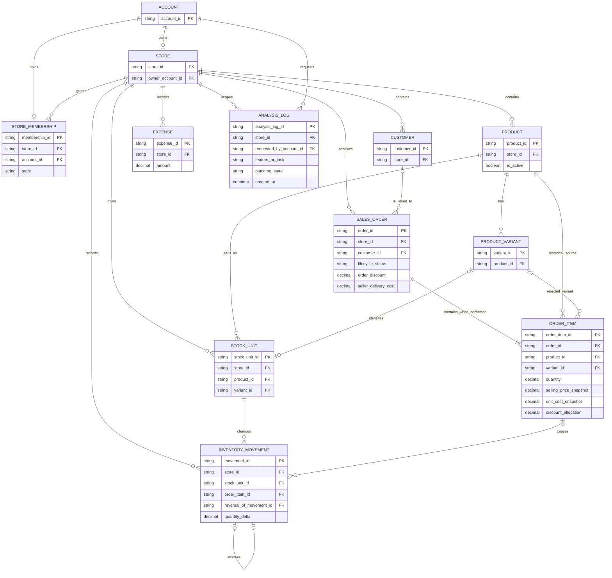

# SellerOS logical entity-relationship design

**Status:** DB-01 logical design record. This is an editable ERD, not a Django model, migration, or API contract. Its field-level choices are defined by the later [DB-02 data dictionary](data-dictionary.md).

## 1. Purpose and design boundary

This design preserves the approved one-store-per-owner prototype policy and store-scoped operational history. It covers accounts and stores, catalogue/variants, inventory movements, customers, orders/items, expenses, and minimized analysis/AI logs. It is based on [the access decision](decisions/auth-and-store.md), [order and inventory rules](decisions/order-and-inventory.md), [analytics decisions](decisions/analytics-and-ai.md), [data/provider policy](decisions/data-and-provider.md), and [proposal traceability](requirements/traceability.csv).

The diagram deliberately does not model a payment gateway, courier/social-commerce integration, accounting ledger, provider credential, autonomous action, or multi-store enterprise account. Those are outside the approved prototype scope.

### Notation

- `||` means exactly one, `o|` zero or one, `o{` zero or many, and `|{` one or many.
- `PK` is a logical primary key; `FK` is a logical foreign key. DB-02 selects UUID physical keys and opaque UUID API IDs.
- `NULL` in the entity notes means an optional relationship, not an authorization fallback.
- Every direct or inherited store relationship must be validated against the authorized store. A foreign key by itself is not sufficient store isolation.

## 2. Logical ERD

`STOCK_UNIT` is a logical stock-bearing identity, not a pre-approved extra feature or physical table. It makes it possible for an inventory movement to have one unambiguous subject whether a store sells a product directly or through a variant. The exact product-versus-variant inventory mapping is intentionally deferred below.

## 3. Entity ownership, keys, and required constraints

| Entity | Ownership and key | Required relationship/constraint | Open field or uniqueness question |
| --- | --- | --- | --- |
| Account | `account_id` is the PK and has no tenant parent. | It may own zero or one store, or hold zero or one staff membership; it cannot do both or participate in two stores. | DB-02 selects UUID IDs and email/password authentication fields; recovery/verification delivery remains outside this ERD. |
| Store | `store_id` PK; `owner_account_id` non-null FK and unique. | Exactly one owner; an owner has at most one store. Store is the tenant root for operational records. | Store profile field dictionary and ownership-transfer/deletion policy remain open (AD-04). |
| StoreMembership | `membership_id` PK; `store_id` and `account_id` non-null FKs. `account_id` is unique under the selected one-store staff policy. | One membership has one state such as active/revoked; only the store owner can provision or revoke it. Cross-table validation prevents an owner from also being staff. | History/re-enrolment representation after revocation is **[DECISION REQUIRED] ERD-02**; it must not weaken one-store participation. |
| Product | `product_id` PK; `store_id` non-null FK. | Belongs to one store and supports the required active/deactivated state. | **[DECISION REQUIRED] D-08 / ERD-03:** SKU scope/uniqueness, category representation, archive/delete details, and whether variantless products use a stock unit. |
| ProductVariant | `variant_id` PK; `product_id` non-null FK. | A variant belongs to one product and therefore its store; it cannot be linked to another store's order or stock identity. | **[DECISION REQUIRED] D-08 / ERD-03:** mandatory/optional variants, variant SKU uniqueness, and stock ownership rule. |
| StockUnit | `stock_unit_id` PK; direct `store_id` and `product_id` FKs; `variant_id` is nullable. | Product/store and optional variant must agree. A stock unit is the only subject of a movement. | **[DECISION REQUIRED] D-08 / ERD-03:** exact unique constraints for a product without variants versus each variant, and whether current balance is stored or derived from the ledger. |
| InventoryMovement | `movement_id` PK; `store_id` and `stock_unit_id` non-null FKs; `order_item_id` and `reversal_of_movement_id` are nullable FKs. | Quantity delta is nonzero. Order-driven deductions/restorations link to the relevant item; a restoration links to its original deduction. Non-order adjustments have no order item. | **[DECISION REQUIRED] ERD-04 / DR-05:** quantity granularity and adjustment vocabulary; **ERD-05:** operation/idempotency key and exact reversal uniqueness. |
| Customer | `customer_id` PK; `store_id` non-null FK. | Belongs to exactly one store. A sale may link one customer or no customer. | **[DECISION REQUIRED] D-08 / ERD-06:** duplicate matching, optionality policy, and delete/anonymization behavior. |
| SalesOrder | `order_id` PK; `store_id` non-null FK; `customer_id` nullable FK. | Every order is store-scoped. Its customer, items, products, variants and movements must all be same-store. Seller-paid delivery cost is an order field, separate from general expenses. | **[DECISION REQUIRED] DR-01:** `New` versus `PENDING`; **DR-04/05/07/08:** monetary precision, empty-draft/quantity handling, timezone, and snapshot edit timing. |
| OrderItem | `order_item_id` PK; `order_id` and `product_id` non-null FKs; `variant_id` nullable FK. | It retains product/variant identity, display name where needed, quantity, selling-price snapshot, confirmation-time unit-cost snapshot, and discount allocation. A confirmed order has one or more items. | A draft's item cardinality and all physical constraints await DR-05/DR-08. Repeating the same product/stock unit across lines is allowed only if later operations aggregate demand atomically. |
| Expense | `expense_id` PK; `store_id` non-null FK. | General operating expense belongs to one store. It has no implicit order FK, because it must not be arbitrarily allocated to an order. | **[DECISION REQUIRED] DR-06/DR-08:** permitted categories, period aggregation, corrections and any separately approved order-specific cost. |
| AnalysisLog | `analysis_log_id` PK; `store_id` and `requested_by_account_id` non-null FKs. | One record is tenant-scoped provenance for a seller-requested computation or AI request. It records task, outcome, timestamp, method/model version and minimized input/reference metadata—not credentials or unrestricted raw customer content. | DB-02 selects a 30-day minimized local-log record; provider/model approval and any stored visible result remain **[DECISION REQUIRED] DP-02**. |

The nullable FKs in the diagram are `StockUnit.variant_id`, `InventoryMovement.order_item_id`, `InventoryMovement.reversal_of_movement_id`, `SalesOrder.customer_id`, and `OrderItem.variant_id`. All remaining FKs shown in the table are required unless a later written decision changes the record class.

## 4. Relationship rules and historical integrity

1. **Tenant root:** `Store` is the ownership boundary. Every tenant record has a direct store FK or reaches one through a required parent. Any redundant direct `store_id` (such as on an inventory movement) must equal the parent's store, not be trusted from a client.
2. **Account/store access:** `Store.owner_account_id` enforces the selected one-store-owner rule. `StoreMembership` represents fixed owner-provisioned staff access; active staff can operate only within the assigned store and cannot manage memberships/settings.
3. **Catalogue and stock:** Product variants are optional. A movement changes one stock unit, so a later implementation can prove that confirmation deducts and qualifying cancellation/return restores the same stock identity exactly once. Current stock must never become negative; the database transaction/concurrency design is a later implementation concern.
4. **Sales history:** A sales order belongs to one store and optionally one customer. An order item keeps immutable transactional snapshots, so a later product name, SKU, price, cost, variant, or deactivation change cannot rewrite recorded sales/profit history.
5. **Movements and reversals:** An order item may cause no movement before confirmation, then one deduction and, where eligible, one linked restoration. Manual movement has no order-item link. This reflects the approved no-reservation and once-only effects policy without inventing an adjustment UI or status transition.
6. **Costs:** `SalesOrder.seller_delivery_cost` is distinct from `Expense`. General operating expenses remain store-level records; the design intentionally does not create an automatic expense-per-order allocation.
7. **Analysis/AI provenance:** `AnalysisLog` remains store-scoped and minimally records the input/reference needed to reproduce or evaluate a result. It must not become a place for provider keys, unrestricted prompts, other-store facts, or automatic external actions.

## 5. Logical delete and retention behavior

DB-02 selects the field-level Django deletion policies; later implementation must preserve these logical behaviors.

| Parent/record | Required logical behavior | Reason / remaining decision |
| --- | --- | --- |
| Account and Store | Never cascade-delete the store's operational history. Block or explicitly govern account/store deletion, ownership transfer, retention and support access. | **[DECISION REQUIRED] AD-04.** |
| StoreMembership | Revoke/deactivate access rather than treating membership removal as permission to create another store or join another one. | Historical retention/re-enrolment is **[DECISION REQUIRED] ERD-02.** |
| Product and ProductVariant | Deactivate/archive rather than cascade through order items or inventory movements. Referenced transactional snapshots must remain usable. | Product delete/archive and variant policy are **[DECISION REQUIRED] D-08.** |
| StockUnit and InventoryMovement | Never cascade-delete movement history. Corrections must remain traceable; a restoration must retain its link to the original deduction. | Adjustment/correction form and idempotency constraint are **[DECISION REQUIRED] ERD-04/ERD-05.** |
| Customer | Never cascade-delete orders. Preserve transaction history and choose an approved restrict, anonymization, or null-link approach. | **[DECISION REQUIRED] D-08 / ERD-06.** |
| SalesOrder and OrderItem | Confirmed/processed history must not be physically deleted by a normal operational action. Draft deletion and empty-draft behavior are not yet chosen. | **[DECISION REQUIRED] DR-05/DR-08.** |
| Expense | Preserve entered financial evidence or use an approved correction/audit pattern; do not silently remove it from an aggregate. | Expense correction/retention is **[DECISION REQUIRED] DR-06/DR-08.** |
| AnalysisLog | Retain only the approved minimized provenance for the approved duration; no cascade that hides required evaluation evidence. | **[DECISION REQUIRED] DP-04.** |

## 6. [DECISION REQUIRED] schema decisions

No item in this table is an implicit implementation instruction.

| ID | Decision required before dependent schema/API work | Blocking impact |
| --- | --- | --- |
| ERD-01 | Account identity, physical identifier and activation/recovery rules (AD-02). | Account fields, authentication constraints and registration API. |
| ERD-02 | Staff-membership history and re-enrolment representation after revocation. | Membership uniqueness/history migration and authorization queries. |
| ERD-03 | Variant/stock-unit mapping, SKU uniqueness, category form and product archive/delete semantics (D-08). | Product, variant, inventory and order-item constraints. |
| ERD-04 | Inventory quantity granularity and adjustment/movement vocabulary (DR-05). | Quantity validation and movement types. |
| ERD-05 | Idempotency/operation identity and reversal uniqueness for status effects. | Safe retry, concurrency and duplicate-effect prevention. |
| ERD-06 | Customer deduplication, whether every order must identify a customer, and customer delete/anonymization behavior (D-08). | Customer/order constraint and privacy behavior. |
| ERD-07 | Analysis-log payload/result/evaluation shape, provider/model selection and local/provider retention (DP-02, DP-04). | AI/analytics storage and privacy review. |
| ERD-08 | Monetary precision/currency/rounding, order status name mapping, draft rules, timezone and snapshot correction timing (DR-01, DR-04, DR-05, DR-07, DR-08). | Order validation, aggregates and API contract. |

## 7. Traceability and member review checklist

| Requirement area | ERD evidence |
| --- | --- |
| FR-01 and NFR-01 | `Account` → `Store`, `StoreMembership`, direct/inherited tenant ownership, and no cross-store cascade rule. |
| FR-02–04 | `Product`, optional `ProductVariant`, `StockUnit`, `InventoryMovement`, active/deactivation and low-stock-compatible current-stock design. |
| FR-05–07 | `Customer`, `SalesOrder`, `OrderItem`, same-store references and transactional snapshots. |
| FR-08–10 | Store-scoped delivered/reversal history, delivery cost and general `Expense` inputs for later deterministic calculations. |
| FR-19–20 and AIR-01–03 | Store-scoped minimized `AnalysisLog` with no raw-secret/provider-key field. |
| NFR-02 and NFR-08 | Store isolation, historical preservation, minimization and explicit retention/delete decision gates. |

Both project members should be able to explain and agree on the following before DB-02:

- Start at a store and show how all operational rows are constrained to that store.
- Follow a product/variant to its stock unit, its movements, and any order item that caused a movement.
- Follow a customer to optional orders, then show why order snapshots survive product/customer changes.
- Distinguish seller-paid delivery cost on an order from a general store expense.
- Explain why analysis logs have tenant-scoped, minimized provenance and no secrets.
- Confirm that every `ERD-*`, `AD-*`, `D-08`, `DR-*`, and `DP-*` item above remains **[DECISION REQUIRED]** until a separate decision is recorded.

## 8. DB-01 verification scope

This documentation-only task has no model, migration, API, or runtime behavior to execute. Review should verify that every entity requested by DB-01 appears in the diagram; every FK has stated optionality; every ownership, uniqueness, and delete/retention rule is explicit; and unresolved details are tagged rather than guessed. Future implementation tests belong in the planned backend module tests after DB-02 and later domain tasks.
